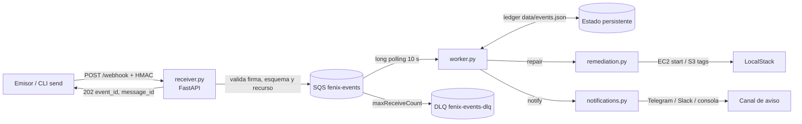

# Proyecto Fénix — Sistema de Autorreparación de Infraestructura

TP Final 1 · Programación para Automatización II · Opción 4.3.1

Sistema que recibe una alerta por webhook autenticado, la guarda en SQS,
repara un recurso emulado con Boto3 sobre LocalStack y comunica el resultado
a Telegram o Slack.

- `node-01` (EC2 mock) pasa de `stopped` a `running`.
- `bucket-01` (S3) recupera sus etiquetas obligatorias.
- Los mensajes válidos se confirman **después** de reparar y avisar.
- Los fallidos se reintentan con backoff y terminan en la DLQ.
- Repetir un evento o reiniciar el worker no repite acciones ya verificadas.

---

## Roles e integrantes

| Rol | Módulos principales | Integrante |
| --- | --- | --- |
| I1 | `utils/errors.py`, `utils/validation.py`, `services/events.py` | Dorado, Tomas |
| I2 | `services/sqs.py`, `services/demo.py` | Herrera, Facundo Ezequiel |
| I3 | `utils/crypto.py`, `services/receiver.py`, `services/remediation.py` (`repair`) | Aramayo, David |
| I4 | `utils/logging_json.py`, `services/notifications.py` | Dorado, Mauricio |
| I5 | `services/worker.py`, `services/remediation.py` (`handle`), `cli.py` | Se dividio tareas|
| I6 | `tests/`, `demo/inject_fault.py` | Se dividio tareas |

---

## Requisitos

- **Python 3.11 o superior**, con la **misma versión en todo el grupo**.
- **Docker** con Docker Desktop iniciado (o Docker Engine + Compose v2).
- **Git**.

---

## Puesta en marcha

### 1. Clonar el repositorio

```bash
git clone <URL-del-repo>
cd proyecto_fenix
```

### 2. Crear y activar la `.venv`

```bash
python -m venv .venv
source .venv/bin/activate
```

En Windows PowerShell:

```powershell
python -m venv .venv
.venv\Scripts\Activate.ps1
```

Actualizar pip dentro del entorno:

```bash
python -m pip install --upgrade pip
```

### 3. Instalar dependencias

Si `requirements-lock.txt` **tiene contenido**, instalación reproducible:

```bash
python -m pip install -r requirements-lock.txt
python -m pip install -e . --no-deps
```

Si `requirements-lock.txt` **todavía está vacío** (aún no se generó):

```bash
python -m pip install -r requirements.txt
python -m pip install -e .
```

### 4. Configurar variables de entorno

```bash
cp .env.example .env
```

En Windows PowerShell:

```powershell
Copy-Item .env.example .env
```

Generar un secreto para el webhook:

```bash
python -c "import secrets; print(secrets.token_urlsafe(32))"
```

Pegar el valor en `WEBHOOK_SECRET` dentro de `.env`.

Completar `LOCALSTACK_AUTH_TOKEN` **solo si** la imagen de LocalStack lo exige.

`.env` no se versiona: nunca commitear tokens ni secretos.

### 5. Levantar LocalStack

```bash
docker compose up -d
docker compose ps
curl -s http://localhost:4566/_localstack/health
```

En Windows PowerShell, usar `curl.exe -s ...` (el alias `curl` apunta a
`Invoke-WebRequest` y no acepta `-s`).

LocalStack queda publicado únicamente en `127.0.0.1:4566`.

- `docker compose down` conserva los recursos (volumen + persistencia).
- `docker compose down -v` borra el volumen y arranca de cero.

### 6. Verificar la instalación

```bash
python -c "import fenix; print(fenix.__file__)"
pytest
```

`import fenix` debe imprimir una ruta dentro de `src/fenix/`.

---

## Variables de entorno

| Variable | Uso |
| --- | --- |
| `LOCALSTACK_AUTH_TOKEN` | Token de LocalStack, solo si la imagen lo exige (vacío por defecto) |
| `AWS_ACCESS_KEY_ID` / `AWS_SECRET_ACCESS_KEY` | Credenciales ficticias aceptadas por LocalStack |
| `AWS_DEFAULT_REGION` | Región del laboratorio (`us-east-1` por defecto) |
| `AWS_ENDPOINT_URL` | Endpoint local; solo se acepta `http://localhost:4566` o `http://127.0.0.1:4566` |
| `WEBHOOK_SECRET` | Secreto compartido para firmar el webhook (generado por el grupo, nunca versionado) |
| `GROUP_ID` | Identificador del grupo usado en los tags `GroupId` y `Owner` |
| `NOTIFY_PROVIDER` | `console`, `telegram` o `slack` |
| `TELEGRAM_BOT_TOKEN` / `TELEGRAM_CHAT_ID` | Credenciales del canal Telegram (solo si se usa) |
| `SLACK_WEBHOOK_URL` | URL entrante de Slack (solo si se usa) |
| `LOG_LEVEL` / `LOG_DIR` / `LOG_MAX_BYTES` / `LOG_BACKUP_COUNT` | Nivel, carpeta y rotación de logs JSON |
| `QUEUE_NAME` / `DLQ_NAME` | Nombres de la cola principal y la DLQ |
| `VISIBILITY_TIMEOUT` / `MAX_RECEIVE_COUNT` | Visibilidad y cantidad de entregas antes de derivar a la DLQ |

Los valores concretos de secretos y tokens no se documentan ni se versionan.

---

## Arquitectura



---

## Contratos de entrada y salida

### Webhook `POST /webhook`

Header obligatorio (exactamente una ocurrencia):

```text
X-Webhook-Signature: t=<epoch>,v1=<hmac_sha256_hex>
```

- La firma cubre **`t` + "." + cuerpo crudo** (los bytes enviados, sin reserializar).
- Ventana de tolerancia del timestamp: **±300 segundos**.
- Cuerpo máximo: **16 KiB**.

Esquema JSON cerrado, sin claves extra ni faltantes:

| Campo | Tipo | Regla |
| --- | --- | --- |
| `schema_version` | entero | Exactamente `1` |
| `event_id` | string | `[a-z0-9-]{3,32}` |
| `event_type` | string | `instance.stopped` o `bucket.tags_missing` |
| `resource_id` | string | `[a-z0-9-]{3,32}`; debe existir en el inventario |
| `occurred_at` | string | ISO 8601 con zona UTC explícita (`Z` o `+00:00`) |
| `simulate_failures` | entero | Entre `0` y `5` |

El `event_type` debe corresponder al tipo del recurso (`ec2` o `s3`) y un
`resource_id` ajeno se rechaza.

### Respuestas del webhook

| Código | Causa |
| --- | --- |
| `202` | Evento validado y publicado; devuelve `{event_id, message_id}` |
| `400` | JSON inválido o cuerpo no UTF-8 |
| `401` | Firma ausente, duplicada, inválida o timestamp fuera de ventana |
| `413` | Cuerpo mayor a 16 KiB |
| `422` | Contrato inválido, claves extra o recurso ajeno/inexistente |
| `500` | `WEBHOOK_SECRET` vacío, inventario ilegible o evento sin `event_id` |
| `503` | Fallo al publicar en SQS o respuesta sin `MessageId` |

### Mensaje en SQS

El worker recibe el evento JSON y lo procesa con visibilidad de 45 segundos.
El resultado de cada evento queda en el ledger `data/events.json`.

---

## Ejecución por terminal

Con LocalStack levantado y el `.env` configurado:

```bash
# 1. Crear cola principal y DLQ
python -m fenix.cli init-queues

# 2. Crear el laboratorio (bucket-01, node-01 y security group)
python -m fenix.cli setup-demo

# 3. Introducir una falla controlada
python -m fenix.cli fault node-01
python -m fenix.cli fault bucket-01

# 4. Levantar el receptor en otra terminal
python -m uvicorn fenix.services.receiver:app --host 127.0.0.1 --port 8000 --workers 1 --env-file .env

# 5. Enviar un evento firmado
python -m fenix.cli send examples/node-event.json
python -m fenix.cli send examples/bucket-event.json

# 6. Procesar la cola (--once consulta una sola vez)
python -m fenix.cli worker
python -m fenix.cli worker --once
```

Los eventos de ejemplo están en `examples/node-event.json` y
`examples/bucket-event.json`.

---

## Reintentos y DLQ

- Long polling de **10 segundos**, un mensaje por consulta.
- Visibilidad de **45 segundos**; `ApproximateReceiveCount` decide el backoff.
- Backoff: `min(30, 2 ** intento)` → **2 s, 4 s, 8 s, 16 s, 30 s**.
- La cola se configura con `RedrivePolicy` hacia `DLQ_NAME` y
  `maxReceiveCount` (por defecto **3**).
- **ACK (borrado del mensaje) solo** cuando la reparación y el aviso quedaron
  verificados y persistidos, o cuando el evento ya estaba completo.
- JSON corrupto, contrato inválido, conflicto de `event_id`, fallo de
  reparación o fallo de aviso **no** se confirman: se reprograma la
  visibilidad y el mensaje termina en la DLQ.
- Los mensajes inválidos nunca se borran a mano: la derivación la hace SQS.
- La DLQ se inspecciona sin borrar el mensaje antes de documentarlo.

---

## Idempotencia

El ledger durable vive en `data/events.json` (o en `FENIX_EVENTS_PATH`) y se
escribe por reemplazo atómico (temporal + `fsync` + `os.replace`).

Estados: `pending` → `retrying` / `failed` → `repair_done` → `completed`.

Orden de trabajo:

1. Se incrementa y persiste `attempts` antes de reparar.
2. Se repara y se persiste `repair_done` con el resultado.
3. Se avisa y se persiste `notified`.
4. Solo entonces se confirma el mensaje en SQS.

Consecuencias:

- Un evento ya `completed` se confirma sin volver a reparar ni avisar.
- Si el proceso cae después de `repair_done` y antes del aviso, al reiniciar
  solo se recupera el aviso pendiente.
- Si el mismo `event_id` llega con otro payload, se marca conflicto y no se
  altera el registro original ni los recursos.
- La reparación es convergente: `node-01` en `running` y `bucket-01` con las
  tags esperadas no se modifican; las tags ajenas del bucket se preservan.

---

## Matriz de pruebas

| ID | Caso | Esperado | Obtenido | Evidencia |
| --- | --- | --- | --- | --- |
| F01 | `init-queues` y `setup-demo` dos veces | Mismas colas y recursos, sin duplicados | Conforme | `evidencias/i2/01`–`05`, `evidencias/i2/pruebas-i2.md` |
| F02 | Nodo detenido + evento firmado válido | Running verificado, ledger completo, aviso y ACK | Conforme | `tests/test_remediation_ec2.py` |
| F03 | Bucket sin Owner | Tags restauradas y tags ajenas preservadas | Conforme | `tests/test_remediation_s3.py` |
| F04 | Firma ausente/alterada y timestamp vencido | `401` y ningún mensaje nuevo | Conforme | `tests/test_receiver.py`, `tests/test_crypto.py` |
| F05 | Mismos datos con bytes distintos tras firmar | `401` por HMAC inválida | Conforme | `tests/test_crypto.py` |
| F06 | JSON roto firmado; luego lista JSON firmada | `400` y `422`, sin publicación | Conforme | `tests/test_receiver.py` |
| F07 | Alias ajeno y claves extra | Rechazo de esquema, sin cambios cloud | Conforme | `evidencias/pruebas-i1.md` |
| F08 | Evento directo a SQS con JSON corrupto | Worker sigue; el mensaje termina en DLQ | Conforme | `evidencias/i2/07-lectura-dlq.png` |
| F09 | `simulate_failures=2` con ID nuevo | Backoff 2 y 4; luego reparación y ACK | Conforme | `tests/test_sqs.py`, `evidencias/i2/pruebas-i2.md` |
| F10 | Falla persistente con ID nuevo | Sin ACK; derivación automática a DLQ | Conforme | `evidencias/i2/07-lectura-dlq.png` |
| F11 | Repetir evento completo y reiniciar worker | Sin nueva reparación ni aviso confirmado | Conforme | Ledger `data/events.json` |
| F12 | Corte entre `repair_done` y aviso | Reinicio recupera solo el aviso pendiente | Conforme | Ledger `data/events.json` |
| F13 | SQS detenido al recibir webhook | `503`, sin aceptación falsa | Conforme | `tests/test_receiver.py` |
| F14 | Aviso `429`/timeout y luego éxito | Reparación no se repite; aviso reintentado | Conforme | `services/notifications.py` |
| F15 | Cambiar payload conservando `event_id` | Conflicto; no altera ledger ni recursos | Conforme | Ledger `data/events.json` |
| F16 | Forzar rotación y abrir el `.gz` | JSON válido, UTC y contexto; sin secretos | Conforme | `tests/test_observability.py`, `evidencias/i4/sample_log.jsonl` |

Pruebas automatizadas:

```bash
pytest
pytest -q tests/test_receiver.py
pytest -q tests/test_remediation_ec2.py tests/test_remediation_s3.py
```

---

## Evidencia del canal elegido

El canal por defecto es `console` (`NOTIFY_PROVIDER=console`). También están
implementados Telegram (`telegram`) y Slack (`slack`); el aviso real del canal
elegido se guarda en `evidencias/`.

- `evidencias/i4/telegram_aviso.png`: aviso enviado a Telegram.
- `evidencias/i4/sample_log.jsonl`: log JSON nominal.
- `evidencias/i4/terminal_pytest.png`: ejecución de la suite.
- `evidencias/i1/`, `evidencias/i2/`: capturas de webhook, SQS, inventario y
  lectura de la DLQ.

Los secretos y tokens no aparecen en las capturas ni en los logs.

---

## Limitaciones

- Todo el laboratorio corre sobre **LocalStack** (S3, SQS, EC2); no se usa AWS
  real. El endpoint está restringido a loopback para evitar envíos externos.
- El worker procesa **un mensaje por vez**; el ledger asume un único proceso
  escritor.
- La entrega de SQS es **al menos una vez**: un corte entre un efecto externo y
  su persistencia puede repetir una reparación o un aviso.
- Las notificaciones dependen del proveedor configurado; sin credenciales se
  usa `console`.

---

## Datos de runtime

- `data/`: inventario y ledger. Propios de cada máquina; **no se versionan**.
- `logs/`: logs JSON y rotación gzip. Propios de cada máquina.
- `evidencias/`: copias anonimizadas para la corrección. **Sí se versionan**.

No borrar `data/` mientras existan recursos en LocalStack: contiene los IDs
que permiten reconocerlos.

---

## Limpieza del laboratorio

1. Detener el receptor y el worker (`Ctrl+C`).
2. Limpiar únicamente los IDs registrados en `data/inventory.json`:
   terminar la instancia EC2, vaciar y borrar el bucket y eliminar el security
   group cuando no esté en uso.
3. Documentar la lectura de la DLQ **antes** de destruir las colas.
4. Reset total del entorno:

```bash
docker compose down -v
rm -f data/inventory.json
docker compose up -d
```

`docker compose down` conserva los recursos; `down -v` borra el volumen.

---

## Dependencias: `requirements.txt` vs `requirements-lock.txt`

| Archivo | Qué contiene | Para qué |
| --- | --- | --- |
| `requirements.txt` | Solo mínimos (`paquete>=version`) | Declara el piso de compatibilidad |
| `requirements-lock.txt` | Versiones exactas (`paquete==version`) | Instalación reproducible |

El lock se genera después de instalar y verificar:

```bash
python -m pip freeze --exclude-editable > requirements-lock.txt
```

Se usa `--exclude-editable` para no guardar la ruta absoluta del proyecto.

---

## Estructura del proyecto

```text
src/fenix/
├── cli.py
├── config/
│   └── settings.py
├── demo/
│   └── inject_fault.py
├── services/
│   ├── cloud_support.py
│   ├── demo.py
│   ├── events.py
│   ├── notifications.py
│   ├── receiver.py
│   ├── remediation.py
│   ├── sqs.py
│   └── worker.py
└── utils/
    ├── crypto.py
    ├── errors.py
    ├── logging_json.py
    ├── state.py
    └── validation.py

tests/
├── test_cloud_support.py
├── test_contracts.py
├── test_crypto.py
├── test_demo.py
├── test_i1_validation.py
├── test_observability.py
├── test_receiver.py
├── test_receiver_sqs.py
├── test_remediation_ec2.py
├── test_remediation_s3.py
├── test_settings.py
├── test_sqs.py
└── test_state.py

examples/
data/          # runtime, no se versiona
logs/          # runtime, no se versiona
evidencias/    # capturas y recortes anonimizados, sí se versiona
docker-compose.yaml
```

---

## Problemas comunes

| Síntoma | Causa probable |
| --- | --- |
| `docker: command not found` | Docker Desktop no está iniciado o no está instalado |
| LocalStack pide Auth Token | Completar `LOCALSTACK_AUTH_TOKEN` en `.env` |
| `import fenix` falla | `.venv` sin activar o falta `pip install -e .` |
| Webhook responde `401` | `WEBHOOK_SECRET` distinto entre emisor y receptor, o timestamp vencido |
| Webhook responde `503` | LocalStack o SQS no están disponibles |
| `EndpointConnectionError` | LocalStack no está levantado en `127.0.0.1:4566` |

---

## Video de la defensa

```text
[(https://drive.google.com/file/d/1BBVYCDmo9SYnfBj6O0cmEPIIrWoc3m_3/view?usp=sharing)](https://drive.google.com/file/d/1BBVYCDmo9SYnfBj6O0cmEPIIrWoc3m_3/view?usp=sharing)
```
