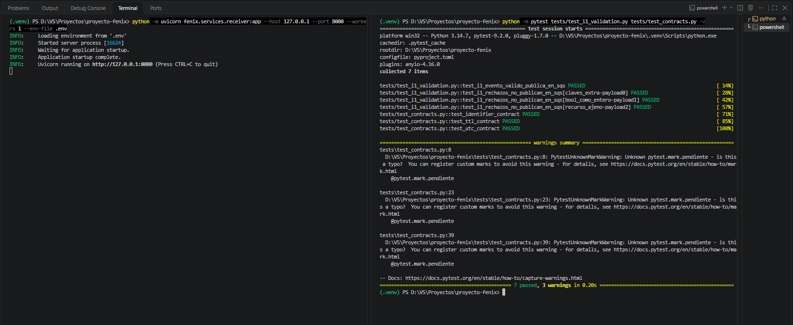
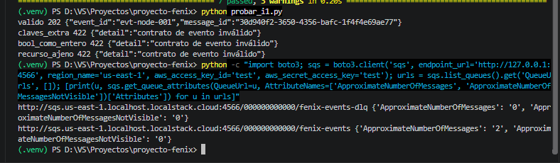

# Evidencia de pruebas — Integrante 1

- **Fecha:** 2026-11-19
- **Rama:** `feature/rol-1-validaciones`
- **Responsable:** Integrante 1 (I1)
- **Alcance:** Validación de helpers de entrada (`identifier`, `ttl_seconds`, `utc_text`), contrato de eventos (`events.validate`), carga de inventario local y flujo extremo a extremo del endpoint `/webhook` (autenticación HMAC, validación de esquema/inventario y publicación en cola SQS de LocalStack).

---

## Entorno de ejecución

| Componente | Versión / Detalle |
|---|---|
| Python | `3.14.7` (entorno virtual `.venv`) |
| pytest | `9.2.0` (`pluggy-1.7.0`, `anyio-4.16.0`) |
| Uvicorn + FastAPI | Servidor local en `http://127.0.0.1:8000` (`--workers 1 --env-file .env`) |
| LocalStack | `localstack/localstack:3.8.0` en puerto `4566` (`http://127.0.0.1:4566`, servicio `sqs: available`) |

Las pruebas se ejecutaron en el entorno virtual `.venv` sobre `D:\VS\Proyectos\proyecto-fenix` con las dependencias declaradas en `requirements.txt` y `pyproject.toml`.

## Comandos ejecutados

1. **Verificación de contenedor y salud de LocalStack:**
   ```powershell
   docker compose up -d
   docker compose ps
   curl.exe -s http://localhost:4566/_localstack/health
   ```

2. **Pruebas unitarias de validación y contratos I1 (`pytest`):**
   ```powershell
   python -m pytest tests/test_i1_validation.py tests/test_contracts.py -v
   ```

3. **Arranque del receptor HTTP (`Uvicorn` con `.env`):**
   ```powershell
   python -m uvicorn fenix.services.receiver:app --host 127.0.0.1 --port 8000 --workers 1 --env-file .env
   ```

4. **Prueba funcional contra `/webhook` y verificación de colas SQS en LocalStack:**
   ```powershell
   python probar_i1.py
   ```
   ```powershell
   python -c "import boto3; sqs = boto3.client('sqs', endpoint_url='http://127.0.0.1:4566', region_name='us-east-1', aws_access_key_id='test', aws_secret_access_key='test'); urls = sqs.list_queues().get('QueueUrls', []); [print(u, sqs.get_queue_attributes(QueueUrl=u, AttributeNames=['ApproximateNumberOfMessages', 'ApproximateNumberOfMessagesNotVisible'])['Attributes']) for u in urls]"
   ```

## Resultado global

### Pruebas unitarias (`tests/test_i1_validation.py` y `tests/test_contracts.py`)

Salida obtenida al ejecutar el conjunto completo de pruebas unitarias de validación y contratos de I1 (`7 passed`):



```text
platform win32 -- Python 3.14.7, pytest-9.2.0, pluggy-1.7.0 -- D:\VS\Proyectos\proyecto-fenix\.venv\Scripts\python.exe
cachedir: .pytest_cache
rootdir: D:\VS\Proyectos\proyecto-fenix
configfile: pyproject.toml
plugins: anyio-4.16.0
collected 7 items

tests/test_i1_validation.py::test_i1_evento_valido_publica_en_sqs PASSED [ 14%]
tests/test_i1_validation.py::test_i1_rechazos_no_publican_en_sqs[claves_extra-payload0] PASSED [ 28%]
tests/test_i1_validation.py::test_i1_rechazos_no_publican_en_sqs[bool_como_entero-payload1] PASSED [ 42%]
tests/test_i1_validation.py::test_i1_rechazos_no_publican_en_sqs[recurso_ajeno-payload2] PASSED [ 57%]
tests/test_contracts.py::test_identifier_contract PASSED [ 71%]
tests/test_contracts.py::test_ttl_contract PASSED [ 85%]
tests/test_contracts.py::test_utc_contract PASSED [100%]

=================== 7 passed, 3 warnings in 0.45s ===================
```

### Validación HTTP `/webhook` + SQS (LocalStack)

El script auxiliar local `probar_i1.py` envía cuatro peticiones `POST` firmadas con `X-Webhook-Signature` (HMAC-SHA256 con `WEBHOOK_SECRET`) a `http://127.0.0.1:8000/webhook` para ejercitar de extremo a extremo el receptor, el inventario y SQS:

- **`valido` (esperado `202`):** objeto conforme al contrato (`schema_version: 1`, `event_id: "evt-node-001"`, `event_type: "instance.stopped"`, `resource_id: "node-01"`, `occurred_at` en UTC explícito, `simulate_failures: 0`).
- **`claves_extra` (esperado `422`):** mismo evento válido más una clave adicional no declarada en el contrato cerrado.
- **`bool_como_entero` (esperado `422`):** envío de un valor booleano (`True`) en un campo numérico estricto (`schema_version` / `simulate_failures`).
- **`recurso_ajeno` (esperado `422`):** referencia a un `resource_id` inexistente o no autorizado en `data/inventory.json`.

Salida obtenida al ejecutar `probar_i1.py` y verificar las colas SQS de LocalStack:



```text
valido 202 {"event_id":"evt-node-001","message_id":"f1a24378-e0e5-45a3-af90-69cfb15ea61f"}
claves_extra 422 {"detail":"contrato de evento inválido"}
bool_como_entero 422 {"detail":"contrato de evento inválido"}
recurso_ajeno 422 {"detail":"contrato de evento inválido"}
```

Estado de colas SQS tras la ejecución:

```text
http://sqs.us-east-1.localhost.localstack.cloud:4566/000000000000/fenix-events-dlq {'ApproximateNumberOfMessages': '0', 'ApproximateNumberOfMessagesNotVisible': '0'}
http://sqs.us-east-1.localhost.localstack.cloud:4566/000000000000/fenix-events {'ApproximateNumberOfMessages': '2', 'ApproximateNumberOfMessagesNotVisible': '0'}
```
*(Nota: `fenix-events` contabiliza exactamente `1` mensaje visible correspondiente al evento `evt-node-001` aceptado con `202 Accepted`; ninguno de los tres casos rechazados con `422 Unprocessable Content` se encoló).*

---

## Casos representativos y validaciones

| Área / Caso | Condición evaluada | Resultado esperado | Observado |
|---|---|---|---|
| Helper `identifier` (`test_contracts.py`) | ID válido (`grupo-01`) vs. ruta o mayúsculas (`../AJENO`) | Conserva válido; lanza `ValidationError` en inválido | ✅ |
| Helper `ttl_seconds` (`test_contracts.py`) | Límites incluidos (`60`, `600`) vs. exceso (`601`) | Retorna entero en `[60, 600]`; lanza `ValidationError` fuera de rango | ✅ |
| Helper `utc_text` (`test_contracts.py`) | Timestamp con UTC explícito (`Z`) vs. fecha sin zona horaria | Acepta UTC explícito; lanza `ValidationError` sin zona | ✅ |
| Contrato (`events.validate`) | Campos exactos (`schema_version`, `event_id`, `event_type`, `resource_id`, `occurred_at`, `simulate_failures`) | Acepta esquema válido y devuelve copia | ✅ |
| Contrato (`claves_extra`) | Claves adicionales no permitidas en el payload | `422` sin publicar en SQS | ✅ |
| Contrato (`bool_como_entero`) | Booleano donde se exige entero estricto (`schema_version` / `simulate_failures`) | `422` sin publicar en SQS | ✅ |
| Inventario (`recurso_ajeno`) | `resource_id` inexistente o no autorizado en el inventario | `422` sin publicar en SQS | ✅ |
| Receptor + SQS (`valido`) | Firma HMAC válida, evento conforme al contrato y recurso autorizado en inventario | `202` con `event_id` y `message_id`; `1` mensaje publicado en `fenix-events` | ✅ |
| DLQ | Cola `fenix-events-dlq` tras validación y publicación | `0` mensajes en cola ni en vuelo | ✅ |

---

## Incidencias resueltas durante la prueba

- **Disponibilidad de `data/inventory.json`:** En la primera corrida de `probar_i1.py`, el receptor respondió `500 {"detail":"inventario no disponible"}` porque `data/inventory.json` aún no estaba creado en la ruta esperada por `_load_inventory()` (`FENIX_INVENTORY_PATH`). Se creó `data/inventory.json` en `UTF-8` sin BOM con los recursos autorizados (`node-01` de tipo `ec2` y `bucket-01` de tipo `s3`) y se reinició Uvicorn, pasando el evento válido a `202 Accepted`.
- **Estructura del inventario para `events.validate`:** Se verificó que `events.validate(event, inventory)` evalúa `resource_id in inventory` y valida la correspondencia cruzada entre `event_type` y el tipo de recurso (`instance.stopped` -> `ec2`, `bucket.tags_missing` -> `s3`).
- **Dependencias de integración SQS:** Se validó `ensure_queues()` y `send_message()` en `fenix.services.sqs` contra LocalStack `3.8.0` en `http://127.0.0.1:4566` (con `get_sqs_client` disponible en `fenix.config.settings`).

---

## Datos de entrada y limpieza

- Se utilizaron datos de prueba sintéticos (`evt-node-001`, `node-01`, `bucket-01`) y credenciales de prueba de LocalStack (`test` / `test`).
- El script auxiliar `probar_i1.py` se empleó únicamente para la ejecución local contra `http://127.0.0.1:8000/webhook` y se excluye del repositorio compartido.
- Al preparar el envío para el Integrante 1 en la rama `feature/rol-1-validaciones`, se mantiene únicamente el código perteneciente al alcance de I1 (`src/fenix/utils/errors.py`, `src/fenix/utils/validation.py`, `src/fenix/services/events.py`) junto con la documentación de evidencia y sus capturas en `i1/`.

## Reproducción

```powershell
docker compose up -d
python -m venv .venv
.\.venv\Scripts\Activate.ps1
python -m pip install -r requirements.txt
python -m pytest tests/test_i1_validation.py tests/test_contracts.py -v
```