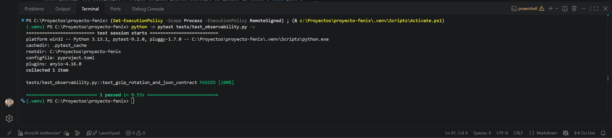
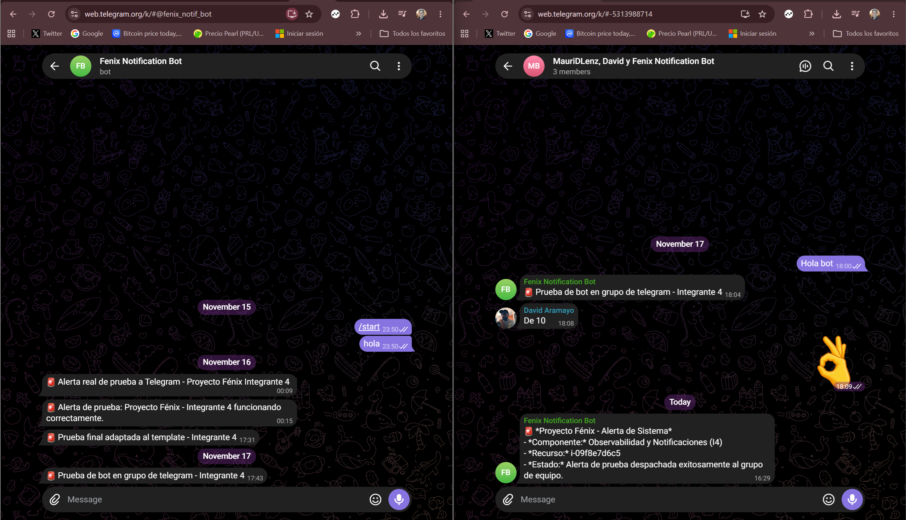

# Evidencia de pruebas y observabilidad — Integrante 4

- **Fecha:** 2026-11-18
- **Rama:** `docs/i4-evidencias`
- **Responsable:** Integrante 4 (I4)
- **Alcance:** Pipeline de logging estructurado JSON con rotación comprimida (`.gz`), jerarquía de excepciones de worker y adaptador HTTP de notificaciones (Telegram).

---

## Entorno de ejecución

| Componente | Versión |
|---|---|
| Python | 3.13.1 |
| pytest | 9.2.0 |
| requests | 2.32.3 |

Las pruebas se ejecutaron en el entorno virtual del proyecto con las dependencias declaradas en `requirements.txt` y `pyproject.toml`.

## Comando ejecutado

```powershell
python -m pytest tests/test_observability.py -v
```

## Resultado global

```text
tests/test_observability.py::test_gzip_rotation_and_json_contract PASSED [100%]

1 passed in 0.53s
```

| Archivo | Área | Casos | Resultado | Tiempo |
|---|---|---:|---|---:|
| `tests/test_observability.py` | Logging JSON, Gzip y Notificaciones | 1 | 1 passed | 0.53 s |
| **Total** | | **1** | **1 passed** | **0.53 s** |


## Ejecución y tiempos de pruebas

Salida obtenida al ejecutar el conjunto de pruebas unitarias de observabilidad:




---

## Casos representativos y validaciones

| Módulo / Componente | Caso evaluado | Resultado esperado | Observado |
|---|---|---|---|
| `logging_json.py` | Emisión de logs con diccionario `extra` | Contrato cerrado de campos de correlación (`event_id`, `message_id`, `resource_id`, `attempt`, `action`, `status`) en formato UTC | ✅ |
| `logging_json.py` | Rotación de archivos de log | Umbral reducido (`maxBytes=300`), compresión automática a `.gz` y eliminación del archivo intermedio sin comprimir | ✅ |
| `notifications.py` | Respuesta HTTP exitosa de Telegram | Valida `ok == True` y trunca mensajes mayores a 1000 caracteres | ✅ |
| `notifications.py` | Fallos de red o timeouts HTTP | Lanza `RetryableError` para evitar el borrado prematuro del mensaje en SQS | ✅ |
| `notifications.py` | Credenciales inválidas o error de cliente (4xx) | Lanza `PermanentError` y enmascara la URL privada con `raise ... from None` | ✅ |

---

## Evidencia 1: Líneas JSON válidas correlacionadas

Archivo generado en: [`evidencias/i4/sample_log.jsonl`](i4/sample_log.jsonl)

```json
{"timestamp": "2026-11-18T18:18:49.098160+00:00", "level": "INFO", "message": "Webhook recibido y validado", "process": 431060, "thread": "MainThread", "event_id": "evt-2026-001", "message_id": "msg-8841", "resource_id": "i-09f8e7d6c5", "attempt": 1, "action": "validate_hmac", "status": "ok"}
{"timestamp": "2026-11-18T18:18:49.098715+00:00", "level": "WARNING", "message": "Timeout transitorio en proveedor de avisos", "process": 431060, "thread": "MainThread", "event_id": "evt-2026-001", "message_id": "msg-8841", "resource_id": "i-09f8e7d6c5", "attempt": 1, "action": "notify_telegram", "status": "retrying"}
{"timestamp": "2026-11-18T18:18:49.098832+00:00", "level": "INFO", "message": "Remediacion y aviso completados", "process": 431060, "thread": "MainThread", "event_id": "evt-2026-001", "message_id": "msg-8841", "resource_id": "i-09f8e7d6c5", "attempt": 2, "action": "notify_telegram", "status": "completed"}
```

---

## Evidencia 2: Histórico comprimido (`.gz`)

Verificado mediante la prueba unitaria en `tests/test_observability.py`. Se fuerza una rotación limitando el tamaño del archivo (`maxBytes=300`), lo cual comprime el histórico de logs a formato `.gz` de forma eficiente sin saturar el disco con megabytes innecesarios.


---

## Evidencia 3: Aviso real en Telegram

Alerta despachada exitosamente hacia el grupo de trabajo del equipo (`NOTIFY_PROVIDER=telegram`, chat ID `-5313988714`) mediante el bot configurado. Las excepciones de red o HTTP segregan correctamente los reintentos y evitan filtrar tokens privados en trazas de error (`from None`).

> **Nota aclaratoria de la captura:** En la imagen adjunta se visualiza una comparativa:
> * **Izquierda:** Las primeras pruebas funcionales iniciales donde el bot enviaba mensajes de validación de forma directa a un chat personal.
> * **Derecha:** La validación final e integrada en el grupo de Telegram compartido del proyecto Fénix, recibiendo correctamente la estructura formal de alerta del sistema.



---

## Correspondencia con la matriz del proyecto

| Requisito / Tarea | Cobertura en esta evidencia |
|---|---|
| **I4 - Logging Estructurado** | Líneas JSON válidas con estampa temporal UTC y campos de correlación obligatorios. |
| **I4 - Rotación Gzip** | Rotación automática con compresión verificada bajo límites estrictos de tamaño. |
| **I4 - Notificaciones** | Integración HTTP con Telegram utilizando excepciones custom (`RetryableError` / `PermanentError`). |

## Reproducción

```bash
python -m venv .venv
# En Windows PowerShell:
# .venv\Scripts\Activate.ps1
python -m pip install -r requirements.txt
python -m pytest tests/test_observability.py -v
```